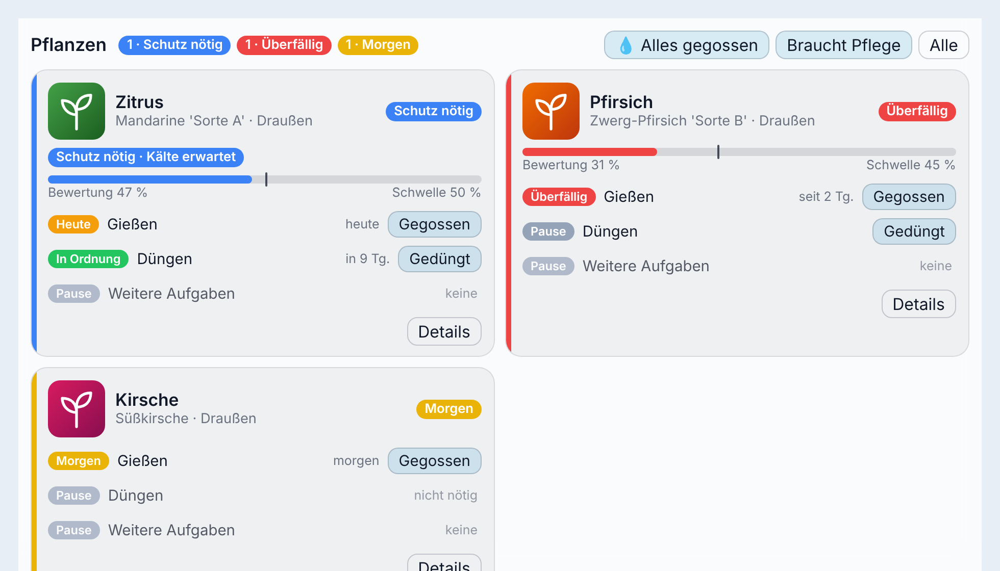
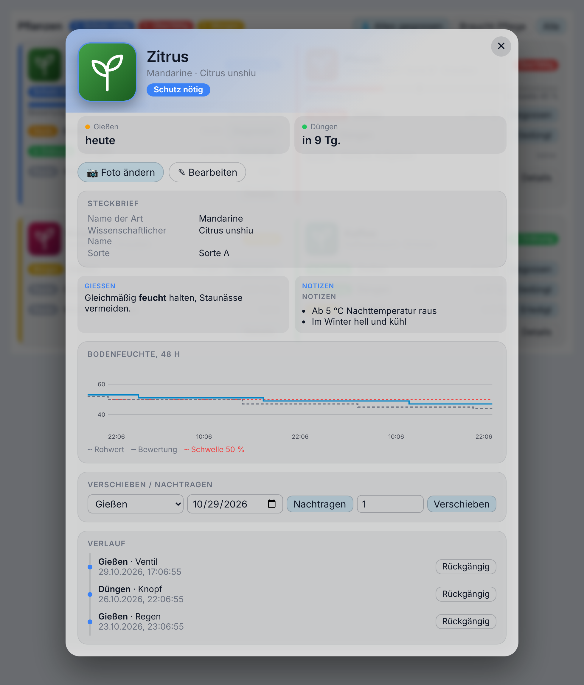
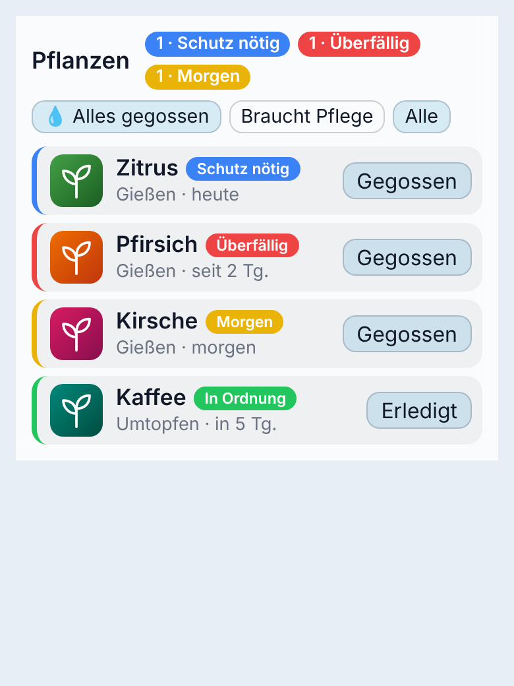

# Rootine

[](https://hacs.xyz)
[](https://www.home-assistant.io)
[](LICENSE)

**Pflegeroutinen für Pflanzen in Home Assistant:** Gießen, Düngen und weitere Aufgaben, mit oder ohne Bodensensor,
mit Steckbrief und Foto pro Pflanze und optionalen Artdaten aus OpenPlantbook.
Alles läuft lokal, ohne eigene Cloud-Anbindung und ohne zusätzliche Abhängigkeiten.

<picture>
  <source media="(prefers-color-scheme: dark)" srcset="images/card-overview-dark.png">
  
</picture>

[](https://my.home-assistant.io/redirect/hacs_repository/?owner=Simon-Albert&repository=ha-rootine&category=integration)

*English summary: see the bottom of this page.*

## Was Rootine kann

- **Jede Pflanze ist ein Gerät** mit eigenem Steckbrief (Art, Sorte, Unterlage, Topf, Herkunft, Pflegetexte, Notizen),
  eigenem Foto, Standort (draußen/drinnen), Aufgaben, Sensoren, Ventil und Grenzwerten.
- **Drei Gieß-Modi:**
  - *Nach Plan:* saisonale Intervalle, z. B. „März–Oktober alle 6 Tage, sonst alle 8“, mit Winterpause.
  - *Plan + Regen:* genug Regen seit dem letzten Gießen zählt als gegossen (nur draußen).
  - *Nach Sensor:* ein geglätteter Feuchtewert (Median über 24 h) entscheidet. Gießen wird automatisch erkannt
    (Feuchtesprung, Ventillauf oder Regen).
- **Wiederkehrende und einmalige Aufgaben:** Düngen und eigene Aufgaben nach Plan, dazu einmalige Aufgaben wie
  „Umtopfen“ mit Datum, auf Wunsch jährlich und mit Erinnerung ein paar Tage vorher.
- **Warnungen:** Frost und Hitze (Sensor und stündliche Wettervorhersage), „zu nass“ bei dauerhaft hoher Feuchte,
  „Sensor prüfen“ bei plötzlichem Abfall, ausbleibenden Meldungen oder schwacher Batterie. Jede Grenze lässt sich
  direkt an ihrem Schalter aus- und wieder einschalten.
- **Knöpfe, Datum, Verschieben, Verlauf:** „Gegossen“, „Gedüngt“, „Erledigt“; „zuletzt“ lässt sich korrigieren;
  falsch erkannte Ereignisse (z. B. Ventil-Testläufe) lassen sich rückgängig machen.
- **To-do-Liste „Pflanzenpflege“**, Sammelsensor „Fällige Pflegeaufgaben“ und die Aktion `rootine.get_due`
  mit fertigen deutschen Sätzen für Sprachansagen.
- **Reparaturhinweise**, wenn ein verknüpfter Sensor, ein Ventil, der Regensensor oder die Wetter-Entität fehlt.
- **Eigene Dashboard-Karte** mit Foto, Status, Verlauf, Diagramm und Steckbrief-Bearbeitung, „Alles gegossen“ und
  einem Kompaktmodus fürs Handy.

## Installation

1. HACS → Benutzerdefinierte Repositories → `https://github.com/Simon-Albert/ha-rootine`, Typ **Integration**.
2. „Rootine“ herunterladen, Home Assistant neu starten.
3. Einstellungen → Geräte & Dienste → Integration hinzufügen → **Rootine**.
   Optional: Regensensor, Regenschwelle, Wetter-Entität, Außentemperatur.
4. Am Rootine-Eintrag **Pflanze hinzufügen**.

Die Dashboard-Karte wird von der Integration selbst bereitgestellt. Nach dem ersten Start einmal den Browser neu laden.

## Eine Pflanze anlegen

1. **Name und Standort.** Mit installierter OpenPlantbook-Integration kannst du eine Art suchen. Leer lassen = von Hand.
2. **Steckbrief.** Alles optional, alles später änderbar, auch das Foto (Handy-Kamera oder Bild aus der Medienübersicht).
3. **Sensoren.** Feuchtesensor, Temperatur, Batterie, Bewässerungsventil, alle optional.
4. **Gießen.** Modus, Plan, bei Sensor die Gieß-Schwelle und die Bewertung, „zuletzt gegossen am“.
5. **Düngen.** Plan (leer = kein Düngen) und „zuletzt gedüngt am“.
6. **Grenzwerte.** Kälteschutz, Hitzeschutz, „zu nass ab“, eigene Regenschwelle. Alle optional.

Später: Zahnrad an der Pflanze → Steckbrief, Foto, OpenPlantbook, Sensoren, Gießen, Düngen, Grenzwerte, weitere
Aufgaben (z. B. „Spinnmilben-Check“) und einmalige Aufgaben. Steckbrief, Foto, Standort, Grenzwerte und einmalige
Aufgaben ändern sich sofort, ohne Neuladen.

### Pläne schreiben

Eine Zeile pro Zeitraum, tolerant bei Leerzeichen und Strichen:

```
01.03.–31.10.: 6
01.11.–28.02.: 8
```

```
01.03.–31.08.: 14
01.09.–28.02.: Pause
```

`ganzjährig: 7` gilt das ganze Jahr. Lücken zwischen Zeiträumen bedeuten Pause. „bis 28.02.“ schließt im Schaltjahr den
29.02. ein. Bei Sensor-Pflanzen ist der Plan ein optionales „spätestens alle n Tage“.

### Einmalige Aufgaben

Zahnrad an der Pflanze → **Einmalige Aufgaben** → hinzufügen, bearbeiten oder löschen. Eine einmalige Aufgabe hat
einen Namen, ein Datum und optional:

- **Jährlich wiederholen:** Nach dem Erledigen springt sie aufs nächste Jahr (der 29.02. wird zum 28.02.).
- **Tage vorher erinnern:** Ab dann steht sie auf der To-do-Liste und in `get_due` („ist in 5 Tagen fällig“).
  Ohne Erinnerung erscheint sie wie jede Aufgabe am Vortag als „morgen“.

Am Tag selbst ist sie „heute fällig“, danach „überfällig“. Erledigt (Knopf in der Karte, To-do-Liste oder
`rootine.mark_done`) landet sie im Verlauf; eine einmalige verschwindet, eine jährliche bleibt mit dem neuen Datum.
„Rückgängig“ im Verlauf holt sie zurück. Der Pflegestatus der Pflanze zeigt eine Erinnerung erst ab dem Vortag.

### Grenzwerte ein- und ausschalten

Kälteschutz, Hitzeschutz und „zu nass“ haben neben ihrem Zahlenwert je einen Schalter (Gerät → Konfiguration).
Aus: Die Grenze gilt nicht mehr, der Wert wird gemerkt. Ein: Der gemerkte Wert gilt wieder, ohne gemerkten Wert
5 °C, 32 °C bzw. 85 %. Einen Wert einzutragen schaltet die Grenze ebenfalls ein.

### OpenPlantbook

Nur eine Vorbefüllung: Name, wissenschaftlicher Name, Bild und Pflegetexte. Was du von Hand änderst, überschreibt
„Daten neu laden“ nie. Die Feuchtegrenzwerte von OpenPlantbook werden bewusst nicht übernommen, sie passen nicht zur Skala
vieler Bodensensoren.

## Reparaturen

Fehlt eine verknüpfte Entität (gelöscht, umbenannt oder deaktiviert), erscheint unter **Einstellungen → Reparaturen**
ein Hinweis, z. B. „Kaffee: Feuchtesensor fehlt“. Das gilt für Feuchte-, Temperatur- und Batteriesensor, das Ventil,
den Regensensor, die Wetter-Entität und den Außensensor. **Beheben** öffnet ein Formular: andere Entität wählen oder
das Feld leer lassen, um die Verknüpfung zu lösen. Kommt die Entität zurück, verschwindet der Hinweis von selbst.
Rootine prüft erst, wenn Home Assistant vollständig gestartet ist; eine Entität, die gerade noch lädt, gilt nicht als
fehlend.

## Aktionen

| Aktion | Wirkung |
|---|---|
| `rootine.mark_done` | Aufgabe erledigt setzen, optional rückwirkend (`when`) und mit Notiz. `task` ist der Aufgabenschlüssel oder die ID einer einmaligen Aufgabe |
| `rootine.postpone` | Fälligkeit um 1–60 Tage verschieben, auch für einmalige Aufgaben |
| `rootine.get_due` | **Antwort** mit allen fälligen Aufgaben und Warnungen, inklusive `text` für Sprachausgabe |
| `rootine.add_oneoff` | Einmalige Aufgabe anlegen (`name`, `due`, `yearly`, `remind_days`), **Antwort** mit ihrer `id` |
| `rootine.update_oneoff` / `rootine.remove_oneoff` | Einmalige Aufgabe ändern oder löschen (`oneoff_id`) |
| `rootine.update_profile` | Steckbrief-Felder ändern (leerer Text löscht ein Feld) |
| `rootine.set_photo` | Foto setzen; ohne Foto gilt wieder das OpenPlantbook-Bild |
| `rootine.refresh_species` | Artdaten neu laden (`overwrite_manual` überschreibt auch Eigenes) |
| `rootine.get_history` / `rootine.undo_event` | Verlauf lesen, Eintrag rückgängig machen |

Die IDs der einmaligen Aufgaben stehen im Attribut `oneoffs` des Pflegestatus-Sensors. Bei jedem Erledigen feuert
das Ereignis `rootine_task_done` (`plant`, `task`, `task_name`, `source`, `when`) und erscheint im Logbuch.

## Beispiele

**Morgens um 8 Uhr eine Push-Nachricht, wenn etwas fällig ist:**

```yaml
automation:
  - alias: Pflanzen morgens
    triggers:
      - trigger: time
        at: "08:00:00"
    conditions:
      - condition: numeric_state
        entity_id: sensor.rootine_fallige_pflegeaufgaben
        above: 0
    actions:
      - action: notify.mobile_app_mein_handy
        data:
          title: Pflanzen
          message: "{{ state_attr('sensor.rootine_fallige_pflegeaufgaben', 'text') }}"
```

**Sprachbericht mit `get_due`:**

```yaml
script:
  pflanzenbericht:
    sequence:
      - action: rootine.get_due
        data:
          include_soon: true
        response_variable: due
      - action: tts.speak
        target:
          entity_id: tts.piper
        data:
          media_player_entity_id: media_player.wohnzimmer
          message: "{{ due.text }}"
```

**Jedes Frühjahr ans Umtopfen erinnern:**

```yaml
action: rootine.add_oneoff
data:
  entity_id: sensor.zitrone_pflegestatus
  name: Umtopfen
  due: "2027-03-15"
  yearly: true
  remind_days: 7
```

**Auf ein erkanntes Gießen reagieren:**

```yaml
triggers:
  - trigger: event
    event_type: rootine_task_done
    event_data:
      source: valve
```

Alle Entitäts-IDs in den Beispielen sind ausgedacht; deine hängen von den Namen deiner Pflanzen ab.

## Dashboard-Karte

```yaml
type: custom:rootine-card
entity: sensor.zitrone_pflegestatus   # eine Pflanze
```

```yaml
type: custom:rootine-card
mode: overview                        # alle Pflanzen, sortiert nach Dringlichkeit
```

```yaml
type: custom:rootine-card
mode: overview
layout: compact                       # eine Zeile pro Pflanze, fürs Handy
```

<picture>
  <source media="(prefers-color-scheme: dark)" srcset="images/card-detail-dark.png">
  
</picture>

Die Karte zeigt Foto, Status in Farbe, Warnungen, einen Feuchte-Balken mit Gieß-Schwelle und je Aufgabe (auch
einmalige) einen Knopf. „Details“ öffnet Steckbrief (bearbeitbar), Foto ändern, 48-Stunden-Diagramm der Bodenfeuchte
mit Schwelle, Verschieben, Nachtragen und den Verlauf mit „Rückgängig“.
Sie nutzt Theme-Variablen und passt zu gläsernen Dashboards (`--ha-card-background`, `--ha-card-backdrop-blur`).

**Alles gegossen:** Ist bei einer oder mehreren Pflanzen Gießen heute fällig oder überfällig, zeigt die Übersicht den
Knopf „Alles gegossen“. Er fragt vorher nach und nennt die betroffenen Pflanzen. Andere Aufgaben bleiben unberührt;
jede Pflanze lässt sich danach einzeln über ihren Verlauf rückgängig machen.

**Kompaktmodus** (`layout: compact`): eine Zeile pro Pflanze mit Foto-Miniatur, Name, dringendstem Status, nächster
Aufgabe und einem Knopf für die dringendste Aufgabe. Tippen auf die Zeile öffnet die Details. Für schmale Spalten
gedacht; der Render-Test prüft 320 und 380 px Breite ohne seitliches Scrollen.

<picture>
  <source media="(prefers-color-scheme: dark)" srcset="images/card-compact-dark.png">
  
</picture>

## Fertige Automationen (Blueprints)

Zwei Vorlagen zum Importieren, ohne YAML zu schreiben:

| Vorlage | Zweck | Importieren |
|---|---|---|
| **Tägliche Pflege-Erinnerung** | Zur Uhrzeit abfragen, was fällig ist, und deine Aktionen ausführen (z. B. Push). In den Aktionen stehen `text`, `count` und `items`. | [](https://my.home-assistant.io/redirect/blueprint_import/?blueprint_url=https%3A%2F%2Fgithub.com%2FSimon-Albert%2Fha-rootine%2Fblob%2Fmain%2Fblueprints%2Fautomation%2Frootine%2Fdaily_reminder.yaml) |
| **Pflanzenbericht per Sprachausgabe** | Liest zur Uhrzeit vor, was ansteht. | [](https://my.home-assistant.io/redirect/blueprint_import/?blueprint_url=https%3A%2F%2Fgithub.com%2FSimon-Albert%2Fha-rootine%2Fblob%2Fmain%2Fblueprints%2Fautomation%2Frootine%2Fspoken_report.yaml) |

## Regensensoren

Rootine erwartet einen Regensensor in mm, der mit dem Regen steigt: eine Tagessumme, die täglich bei 0 beginnt,
oder ein fortlaufender Zähler.

**Tageswechsel um Mitternacht UTC:** Viele Regenmesser setzen nicht um Mitternacht Ortszeit zurück, sondern um
Mitternacht UTC (in Deutschland 01:00 im Winter, 02:00 im Sommer). Bis dahin zeigen sie noch die Summe vom Vortag.
Rootine zählt deshalb nur die Zuwächse und ordnet jeden dem Ortsdatum zu, an dem er gemessen wurde. Ein Rückgang gilt
als Rücksetzung, nicht als Regen. Der Wert beim Start ist nur Ausgangspunkt: Ein Neustart oder eine Meldung kurz nach
Mitternacht zählt die Vortagssumme nicht als heutigen Regen.

**Erster Start:** Hat Rootine noch keine eigenen Regenwerte, übernimmt es die letzten Tage aus dem Attribut
`daily_history` des Sensors, falls vorhanden. Diese Tage sind nach UTC gebildet, nicht nach Ortszeit, und deshalb nur
eine Näherung. Ab dann zählt Rootine selbst.

## Fotos aufräumen

Rootine speichert nur den Verweis auf das hochgeladene Bild und **löscht nie Bilder**, auch nicht beim Ersetzen oder
beim Löschen einer Pflanze. Aufräumen: Medien → Hochgeladene Bilder.

## Grenzen

- Keine Licht-, Leitfähigkeits- oder Luftfeuchte-Auswertung (kein Ersatz für Plant Monitor in diesem Teil).
- Rootine sendet selbst keine Benachrichtigungen und steuert keine Ventile.
- Hitze wird nie aus dem Pflanzensensor abgeleitet (der Sensorkopf heizt sich in der Sonne auf), nur aus Vorhersage
  oder Außensensor.
- Der Regen-Modus rechnet mit Regen pro Tag: Regen von gestern und heute seit dem letzten Gießen.
- Kein Kalender, keine Statistik, kein Fotoverlauf.

## English summary

Rootine is a HACS custom integration for plant care routines in Home Assistant. Each plant is a device with a profile
(species, cultivar, pot, care notes), its own photo, tasks with seasonal schedules (watering, fertilizing, custom tasks)
and one-time tasks (optionally yearly, with a reminder some days ahead). Watering works by schedule, schedule plus rain,
or by soil-moisture sensor with automatic detection of watering (moisture jump, valve run or rain). It warns about frost,
heat, waterlogging, sensor problems and low batteries; each limit has its own switch. Missing or renamed linked entities
show up under *Settings → Repairs* with a fix flow. There is a to-do list, a `rootine.get_due` action with ready-made
German texts and a dashboard card with an "all watered" button and a compact layout for phones (`layout: compact`).
Rain is counted from increments per local date, so rain gauges that reset at midnight UTC work correctly.
OpenPlantbook is an optional source to pre-fill the profile; every field stays editable. No cloud, no extra dependencies.
The UI is German first, English included. Install through HACS (custom repository, type *Integration*), then add the
**Rootine** integration and add plants from it.

## Entwicklung

```bash
uv venv .venv && uv pip install --python .venv/bin/python -r requirements_test.txt
.venv/bin/ruff check . && .venv/bin/ruff format --check .
.venv/bin/pytest
```

Die Tests laufen gegen synthetische, frei erfundene Messreihen (`tests/fixtures_synthetic/`, Generator in `scripts/`);
die erwarteten Werte stammen aus einem unabhängigen Orakel (`tests/fixtures_synthetic/reference.py`). Die Karte ist eine
einzelne Datei ohne Build-Schritt (`custom_components/rootine/frontend/rootine-card.js`); der Render-Smoke-Test braucht
Node und Playwright und wird sonst übersprungen.

Lizenz: MIT.
